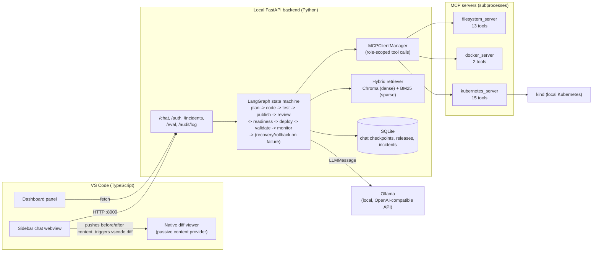

# ReleaseForge AI

An autonomous release-engineering agent for VS Code, for developers who want to hand off a small, well-defined change and review the result rather than write it by hand: describe a change in plain English, and a LangGraph pipeline plans it, writes it, tests it, gets it independently reviewed by a second LLM call, opens a PR, scores it for release readiness, and deploys it to Kubernetes — with a human approval gate at every stage. (A portfolio project, not a production tool — see [Known limitations](#known-limitations).)

## Results

The one number worth checking before reading further: **a single evaluation run of the same exact model + prompt config swung critical-defect catch rate by 16.7 percentage points, run to run, with nothing else changed.** That finding, and what was done about it, is the most distinguishing thing in this repo — see [Evaluation methodology](#evaluation-methodology).

**Review Agent, evaluated on a 58-fixture labeled corpus** (`backend/eval/golden_set/dataset.py`) — 42 fixtures with a deliberately injected defect across 7 categories (6 each: SQL injection, hardcoded secret, missing null check, off-by-one, unhandled exception, N+1 query, race condition), plus 16 clean diffs as negatives.

| Metric | v1 (single run) | Shipped config (mean of 3 runs) | Range across 3 runs |
|---|---:|---:|---:|
| Critical-defect catch rate (n=18) | 100% (18/18) | 92.6% | 83.3% – 100% |
| Overall recall (n=42) | 66.7% (28/42) | 73.0% | 69.0% – 78.6% |
| Precision | 75.7% (28/37) | **97.0%** (pooled: 92/95 = 96.8%) | 93.8% – 100% |
| False positives (per 100 lines, n=16 clean) | 8.65 | **1.0** (pooled: 3 false positives / 16 clean fixtures across 3 runs) | 0.0 – 1.92 |

This is a mixed result, shown as measured: precision and false-positive rate improved substantially and consistently; critical-defect catch rate has a wide range and a lower mean than the original single-run baseline. The shipped config was chosen with that tradeoff visible, not by picking the best-looking run. ("Mean of 3 runs" is each run's percentage averaged, matching what `champion.json` records; "pooled" sums raw true/false-positive counts across all 3 runs first, then computes one ratio — the two agree closely, which is itself a sanity check on the aggregation.)

**Planner Agent, evaluated on 18 fixtures** (`backend/eval/golden_set/planner_dataset.py`) covering three real historical bug classes: 17/18 (94.4%) — a clean 13/13 on target-file selection, file-extension convention, and scope discipline; the one failure was a correct plan phrased in a way a substring-matching grader didn't credit (documented, not hidden — see [Known limitations](#known-limitations)).

**176 automated tests pass in CI** (`backend/tests/`, run via `.github/workflows/ci.yml`), 7 of them exercising the eval harness's own scoring logic.

Source of truth for every number above: [`backend/eval/golden_set/champion.json`](backend/eval/golden_set/champion.json) (the recorded baseline) and the raw per-fixture output it's built from, in [`backend/eval/golden_set/results/`](backend/eval/golden_set/results/).

## Why it exists

Coding agents are common; agents that will actually gate their own output before it reaches production are rarer. The interesting problem here wasn't getting an LLM to write a diff — it was building the scaffolding around that diff: an independent reviewer that doesn't just rubber-stamp its own work, a readiness score built from real signals instead of an LLM's opinion, and a deployment layer that picks a rollout strategy deterministically because a wrong guess there has real consequences.

The harder problem, discovered partway through, was that evaluating any of this honestly is not free — a small local LLM's behavior is noisy enough that a single benchmark run can mislead. That became its own piece of the project (see below).

## Architecture



**Extension** (`extension/src/`) is a thin client: `backendManager.ts` starts the local backend and authenticates; `chatViewProvider.ts` calls `/chat`, and when a proposed change comes back, pushes the before/after content into `diffProvider.ts`'s `OriginalContentProvider` (a passive virtual-document provider — it doesn't call the API itself) and invokes VS Code's built-in `vscode.diff` command; `dashboardPanel.ts` fetches `/eval/summary`, `/audit/log`, and `/incidents` directly.

**Backend** (`backend/app/`) does the actual work. `agents/graph.py` is a LangGraph `StateGraph` with an `interrupt()`-based approval gate before every state-changing step (code write, publish, deploy, rollback). Every tool call — file writes, `git push`, `docker build`, `kubectl apply` — goes through `MCPClientManager`, which enforces per-role tool scoping (`app/security/scopes.py`: 7 roles — `coding`, `test`, `publish`, `build`, `deployment`, `recovery`, `readiness` — each with an explicit allow-list, checked client-side before a call reaches its MCP server).

**Retrieval** (`app/rag/`) combines Chroma (dense embeddings) and BM25 (sparse/keyword) via reciprocal rank fusion, then an LLM-prompted reranker (`app/rag/reranker.py`) — used to ground chat answers in a project's own release/incident history.

## Key design decisions

**1. Deterministic scoring instead of LLM judgment, for anything with real consequences.**
Obvious approach: ask the LLM "is this ready to ship?" and "which deployment strategy should we use?" Instead, both are plain arithmetic over real signals, never an LLM call: `release_readiness()` is a 100-point sum (tests 35, independent review 25, review-stated risk up to 10, dependency scan up to 10, security scan up to 10, infra reachability up to 10); `select_deployment_strategy()` picks Recreate/Rolling/Canary/Blue-Green from tracked deployment state (does this app have a prior deployment on record?) and risk level. Tradeoff: less flexible than letting a model reason freely, but a wrong readiness score or deployment-strategy pick is a production incident, not a code-review miss; determinism was chosen deliberately for that class of decision.

**2. A second, independent LLM call reviews the first one's work.**
Obvious approach: one agent writes code, human approves, done. Instead, `review()` is a separate call that doesn't see the Coding Agent's reasoning, only its diff — explicitly prompted to be skeptical, capped at `MAX_REVIEW_ROUNDS = 2` retry rounds. Tradeoff: a normal task is 3 LLM calls before review (`classify_intent` → `plan` → `code`); review adds one more call per round, up to 2 extra calls if changes are requested twice — real added latency, in exchange for a second opinion before a human ever sees the diff.

**3. Role-scoped tool access, enforced client-side, per MCP call.**
Obvious approach: one shared tool registry all graph nodes can call into. Instead, `MCPClientManager.call_tool(role, tool_name, args)` checks the calling role's allow-list before dispatching — a Coding Agent literally cannot call `delete_deployment`, regardless of what the model tries. Tradeoff: more code to maintain (7 explicit scope sets vs. one flat list), for a real reduction in blast radius if a model is confused or a prompt-injected file tries to talk it into something.

**4. A single eval run is not trusted as ground truth.**
Obvious approach: run the golden set once, record the score, move on. A direct experiment (rerunning one unchanged config 3 times) showed critical-defect catch rate swinging 83.3% → 94.4% → 100.0% with nothing else different. `run_reviewer_golden_set.py` now requires `--num-runs >= 3` before `--update-champion` will accept a new baseline, and reports mean/min/max, not a point estimate:

```python
if args.update_champion and args.num_runs < MIN_RUNS_FOR_CHAMPION:  # MIN_RUNS_FOR_CHAMPION = 3
    print(
        f"REFUSING: --update-champion requires --num-runs >= {MIN_RUNS_FOR_CHAMPION}. A single run's "
        "numbers for this model are not reliable enough to become the recorded baseline..."
    )
    return 1
```

Tradeoff: ~3x the LLM calls (and wall-clock time — tens of minutes per full evaluation) to get a number worth trusting.

**5. Prompts live in versioned files, not inline strings, gated in CI.**
Obvious approach: keep prompts as f-strings inside the node functions that use them (this is in fact how the project started — see `app/prompts/`'s docstring). Moved to `app/prompts/review_agent_v{1,2,3}.txt`, loaded via `string.Template`, with a CI job (`golden-set-prompt-gate`) that fails if a prompt file changes without `champion.json`'s recorded hash being updated to match. Tradeoff: an extra layer of indirection for what could be a one-line string edit, in exchange for making "someone edited a prompt without re-running the eval" structurally impossible to ship silently.

## Evaluation methodology

**Corpus construction** (`backend/eval/golden_set/dataset.py`): each of the 7 defect categories is built from one code template, parameterized across 6 domains (user/order/payment/inventory/session/invoice) so the 6 variants per category are genuinely different code, not copy-pasted. The 16 clean fixtures are hand-written and distinct from each other, since a false-positive rate is meaningless if the negatives aren't varied.

**Grading**: each defect fixture carries a list of keywords its category's real fix would plausibly be named by (e.g., for SQL injection: `"sql injection"`, `"parameteriz"`, `"sanitiz"`). A fixture counts as caught only if the reviewer's actual response text matches — not just for requesting changes at all. This was tightened twice after reading raw output instead of trusting the pass/fail count: once after finding a fixture template that accidentally contained two real defects instead of one (confounding 3 of 6 results), once after finding a reviewer response that was a valid correctness claim phrased in words the original keyword list didn't cover.

**What's measured and why**: catch rate by severity (does it get the things that matter), false-positive rate normalized per 100 lines (the number that decides whether anyone keeps a review tool turned on), and precision/recall as the standard summary. The harness (`run_reviewer_golden_set.py`) calls the real `review()` LangGraph node directly against a real running Ollama instance — not a mock, not a re-implementation.

**Sample size limitations, stated plainly**: 6 fixtures per defect category is enough to notice a category-level pattern (missing-null-check bugs were caught 0/6 times in the original prompt) but too small for the per-category rate itself to be statistically stable — minor-category catch rate alone was observed to swing 0% → 100% across 3 identical runs. The headline critical/precision/recall numbers pool across more fixtures and are more stable, but still carry the same underlying model noise documented above.

## Known limitations

- **No GPT-4/paid-model comparison.** `backend/app/llm/factory.py` only ever returns an Ollama provider; no OpenAI/Anthropic adapter is wired in. Comparing the local model against a frontier model was scoped out rather than faked with invented numbers.
- **CPU-only local inference is slow.** No GPU on the development machine; a single LLM call has been measured between ~35s and ~240s depending on prompt/response length. A full 58-fixture eval run has been measured at ~50 minutes.
- **Cloud deployment (AWS) is not implemented.** Deliberately deferred — it needs real cloud credentials and incurs real billed cost, which wasn't authorized. Kubernetes deployment is real, but only against a local `kind` cluster.
- **Minor-defect catch rate is not a reliable number at n=6** (see above) — reported anyway, with the caveat, rather than dropped.
- **Planner eval grading has known false-negative failure modes.** Substring-keyword matching sometimes fails to credit a correct plan that's phrased differently than expected (documented example in `RELEASEFORGE_BUILD_PLAN.md`, Round 6).
- **The full in-editor approval-click flow hasn't been click-tested end-to-end** in a real running VS Code window (typing a task, clicking Approve, watching a live diff appear) — the backend connection and dashboard rendering were verified live; the full webview interaction loop wasn't.
- **No LICENSE file.**
- **Single-user tool, not multi-tenant.** GitHub OAuth Device Flow gates the API (proving a request comes from an authenticated human), but role scoping (`scopes.py`) is per-agent, not per-account — there's deliberately no user-level RBAC, since there's only ever one real user.

## Quickstart

Requires: Python 3.12, Node 18+, [Ollama](https://ollama.com) running locally with `qwen2.5:7b-instruct`, `qwen2.5-coder:7b`, and `nomic-embed-text` pulled.

```bash
# Backend
cd backend
python -m venv .venv && .venv/Scripts/pip install -r requirements.txt
.venv/Scripts/python -m pytest tests/ -q          # 176 tests, no live LLM needed
.venv/Scripts/python -m eval.golden_set.run_reviewer_golden_set   # re-run the numbers above

# Extension
cd extension
npm install && npm run compile
# then F5 in VS Code to launch an Extension Development Host
```

## Tech stack

Python, FastAPI, LangGraph, MCP SDK, Ollama, ChromaDB, SQLAlchemy/SQLite, TypeScript, VS Code Extension API, Docker, Kubernetes (`kind`), GitHub Actions.
